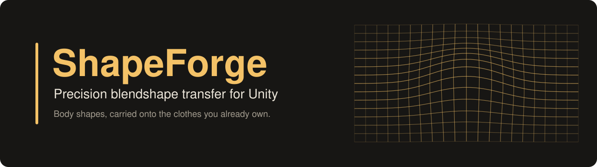
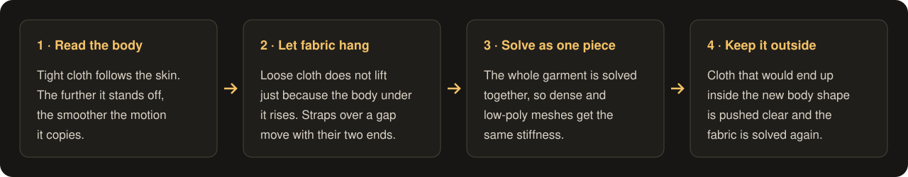

 

**Your avatar has a body shape. Your outfit doesn't. ShapeForge makes it.**

[Install](#install) · [Quick start](#quick-start) · [How it works](#how-it-works) · [Accuracy](#accuracy) · [Limitations](#limitations)

---

ShapeForge copies body blendshapes, such as chest, waist or hip shapes, onto clothing **made for the same avatar**. Check the fit live in the Scene View, touch up any problem spots, and save a new mesh for each garment. Your original meshes are never changed.

## Features

| | |
|---|---|
| 🧵 **Fabric transfer** | Cloth follows the body where it touches. Loose fabric hangs and spans hollows instead of sticking to the skin. |
| 🧱 **Layered outfits** | Pieces are fitted together, with checks for cloth-to-cloth and cloth-to-body intersections. |
| 🎚️ **Authored frames** | Multi-frame source blendshapes keep their positive in-between frames. |
| ✏️ **Scene View editing** | Scrub the fit, isolate pieces, sculpt, smooth, move vertex patches, straighten spans and undo. |
| 🛟 **Non-destructive** | Results are saved as separate mesh assets that keep skinning and existing shapes. **Restore** removes generated shapes. |
| 🔗 **Modular Avatar** | Optional slider sync. It also works without Modular Avatar; you set the garment slider yourself. |

## Install

1. Get **ShapeForge.unitypackage** from [Releases](https://github.com/MironescuOctavian/ShapeForge/releases). No release is published yet; until then, follow the [installation and package guide](docs/INSTALLATION.md).
2. In Unity, choose **Assets → Import Package → Custom Package** and import it.
3. Open **Tools → ShapeForge → Blendshape Generator**.

## Quick start

1. **Pick** the **Body Mesh**, the **Outfit** and the **Source Shape**. You can drag in one garment, or the parent of several pieces.
2. **Check** the pieces you want fitted.
3. Click **Edit** to inspect the fit at **0**, **50** and **100**, or go straight to step 4.
4. Click **Generate**. Done.

<b>Editing controls</b>

 

- In the Scene View, look for **ShapeForge Edit Mode**. Editing starts on **All Cloth**; choose a piece from the cloth list, or use **Select Cloth**, to narrow it down.
- **Back** and **Resume Edit** switch views while keeping your draft.
- **Vertex Control** (<kbd>B</kbd>): click or box-select vertices, then drag the **Move** handle. <kbd>Shift</kbd> adds and <kbd>Ctrl</kbd>/<kbd>Cmd</kbd> subtracts. **Show all vertices** is optional.
- **Straighten Span:** click one attachment, the middle of the strip, then the other attachment. Adjust **Strip half-width** and **Span strength** before applying.
- **Brushes:** <kbd>Shift</kbd> + scroll changes the size, and <kbd>Esc</kbd> cancels a stroke.
- **End Edit** closes a clean draft. With unsaved corrections, choose **Save Corrections** or **Discard**.

## How it works

**Fabric** is the default. The classic **Barycentric**, **Weighted** and **RBF** transfers are still under **Advanced**, so you can compare them in Edit.

## Accuracy

Some outfits already ship with a body shape their creator made by hand. That makes a useful test: remove the creator's shape, let ShapeForge rebuild it, and compare the two. **Higher is closer to the creator.**

| Chest shape tested | Previous solver | **Fabric** |
|---|:---:|:---:|
| No-bra, small *(used for tuning)* | 48.6% | **61.3%** |
| No-bra, large | 55.7% | **57.1%** |
| With bra, normal | 55.9% | **61.4%** |
| With bra, big | 34.6% | **40.0%** |
| Flat | 79.5% | **84.7%** |

On the shape used for tuning, the number of vertices ending up inside the body at full weight fell from **775 to 311**.

> [!NOTE]
> These results come from outfits for **one avatar**, and the Flat row covers only 8 pieces. The score measures how closely each vertex's movement matches the creator's, so 100% would mean an identical shape. It isn't a pass rate. Results vary by outfit, so always check the fit.

## Compatibility

| | |
|---|---|
| **Unity** | Unity 6, developed and validated on 6000.0.67f1. Editor only. |
| **VRChat SDK** | Avatars SDK 3.11.0-beta.1 was used in earlier integration testing. |
| **Modular Avatar** | Optional. Earlier integration testing used 1.19.0. |

## Limitations

- Garments must be made for the same avatar. ShapeForge doesn't convert outfits between avatars.
- Tight cups, straps and stacked panels can still intersect. The clipping check flags suspect contacts, but it can't cover every animation pose.
- Negative authored frame weights aren't supported.
- Layered outfits and extra source frames take longer to generate.

## Development

Work on `main` and follow [AGENTS.md](AGENTS.md). Run the [Unity smoke test](docs/INSTALLATION.md#clean-project-check). See the [changelog](CHANGELOG.md) and the [release-readiness report](docs/SHAPEFORGE_RELEASE_READINESS.md).

**Reporting a bug?** Include your Unity and SDK versions, the blendshape weights, the transfer method, and a reproduction you're allowed to share.

---

Released under the [MIT license](LICENSE).

