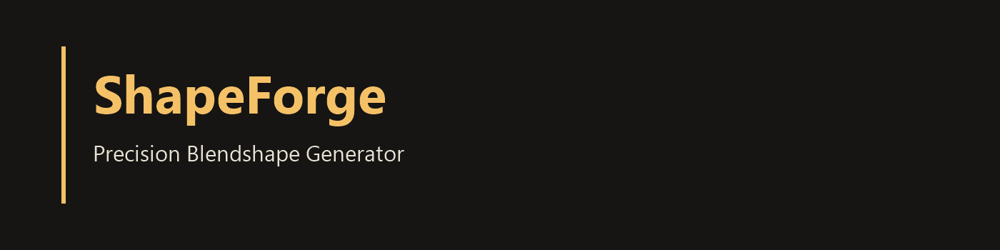
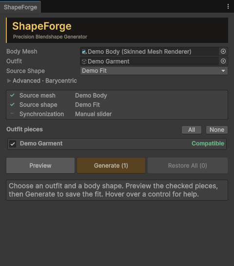
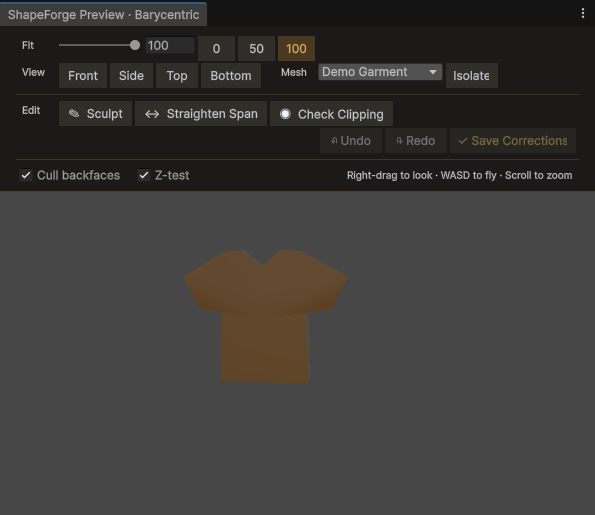

# ShapeForge

ShapeForge transfers body blendshapes to clothing already made for the same avatar. Preview the fit in Unity, correct problem areas, then save a generated mesh for each selected garment.

## Compatibility

- **Unity 6.** Development and package validation target **6000.0.67f1**.
- **VRChat avatars.** Phase 2 was tested with VRChat Avatars SDK **3.11.0-beta.1** and Modular Avatar **1.19.0**. Modular Avatar is optional. Without it, set the generated garment shape manually.
- **Unity Editor only.** The package contains ShapeForge editor scripts and documentation.

## What it does

- Transfers shapes using Barycentric, Weighted or RBF interpolation. Barycentric is the default.
- Preserves authored positive blendshape frames.
- Fits selected pieces together and checks for suspect cloth and body intersections.
- Provides a separate avatar preview with fit scrubbing, fixed views, isolation, sculpting, smoothing, Straighten Span, and correction history.
- Saves a separate mesh asset, preserving original mesh data, skinning, and existing shapes. Restore removes generated shapes.

## Install

Download **ShapeForge.unitypackage** from [GitHub Releases](https://github.com/MironescuOctavian/ShapeForge/releases) once a release is available. For a development build, follow the [installation and package guide](docs/INSTALLATION.md).

In Unity, choose **Assets → Import Package → Custom Package**, select the package, and import it. Open **Tools → ShapeForge → Blendshape Generator**.

## Transfer a shape

1. Select the **Body Mesh**, **Outfit**, and **Source Shape**. You can drag a clothing object or the parent of several pieces from the Hierarchy.
2. Check the eligible pieces you want to fit. Open **Advanced** to choose a transfer method.
3. Open the **Fit Editor**. Choose an outfit mesh at the top left, then compare **0**, **50**, and **100**. In **Clipping**, scan the selected mesh, choose a patch, and preview a fix before applying it.
4. Use **Sculpt**, **Clipping Brush**, **Restore Brush**, or **Relax** to correct the fit. In **Vertex Control** (**B**), drag to select, hold **Shift** to add or **Ctrl/Cmd** to subtract, or use **Straighten Span** for straps. Press **Esc** to clear a selection.
5. Use **Generate** for the automatic fit or **Save Corrections** after editing the preview. Use **Restore** to remove generated shapes.

## Unity interface

The screenshots show the actual Unity windows with a synthetic test outfit.

 

## Outfit demonstrations

The [capture checklist](docs/images/README.md) identifies the stills awaiting permission for publication. Each example needs a real Unity capture at 0%, 50%, and 100% using the same camera and lighting.

## Known limitations

ShapeForge targets garments authored for the same avatar. Existing intersections can remain, especially around tight cups, straps, and stacked panels. The clipping check flags suspect contacts in the preview. It cannot certify all animation poses. Negative authored frame weights are currently unsupported. Layered generation and additional source frames take longer.

## Development

Work on main and follow [AGENTS.md](AGENTS.md). Run the [Unity smoke test](docs/INSTALLATION.md#clean-project-check) and see the [changelog](CHANGELOG.md) and [release-readiness report](docs/SHAPEFORGE_RELEASE_READINESS.md). For bug reports, include Unity and SDK versions, blendshape weights, transfer method, and a shareable reproduction.

[MIT license](LICENSE)
